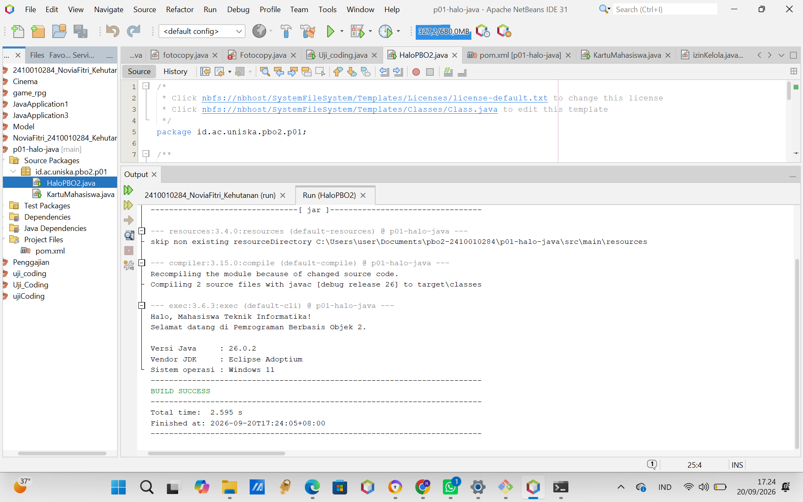
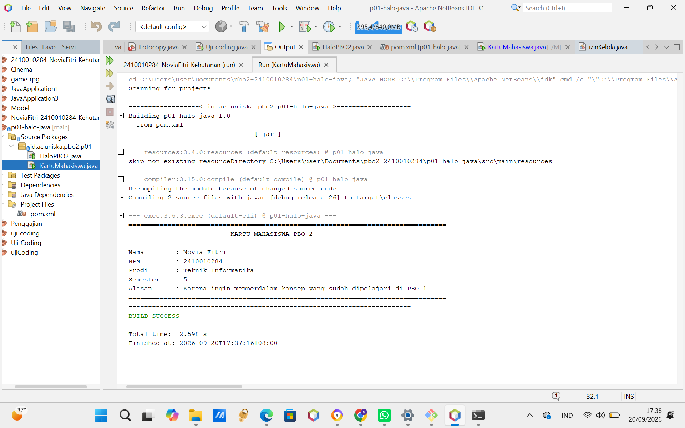
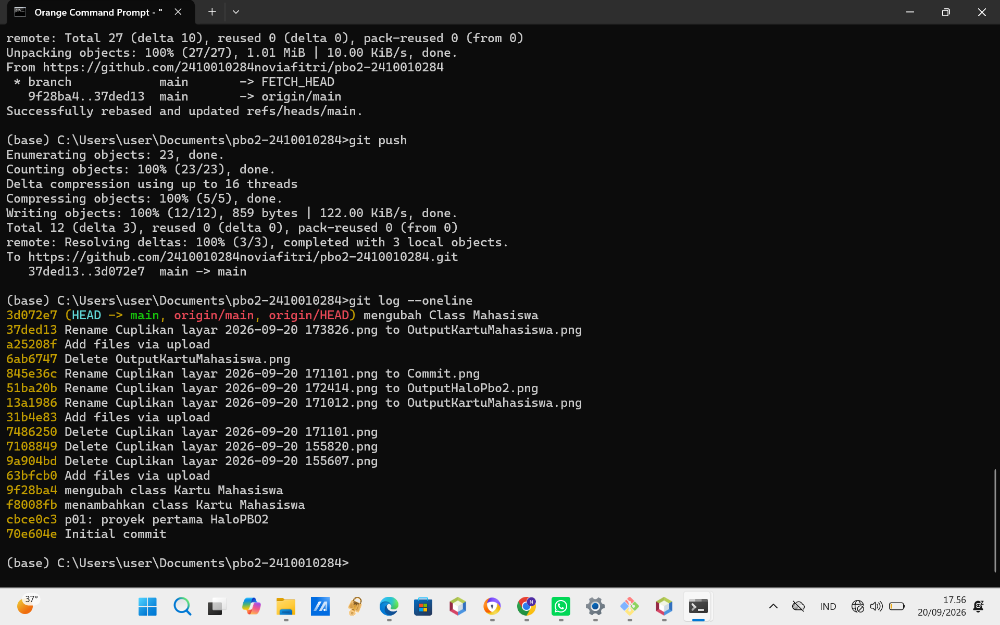

# Tugas Praktikum PBO 2 - Pertemuan 1: Lingkungan Java, Maven, Git.

- **Nama:** Novia Fitri
- **NPM:** 2410010284
- **Mata Kuliah:** Pemrograman Berbasis Objek 2 (PBO 2)

---

## 1. Tangkapan Layar (Screenshots) keluaran program HaloPBO2

## 2. Tangkapan Layar (Screenshots) keluaran program Kartu Mahasiswa

## 3. Tangkapan Layar (Screenshots) hasil perintah git log --oneline yang menunjukkan minimal dua commit

---

