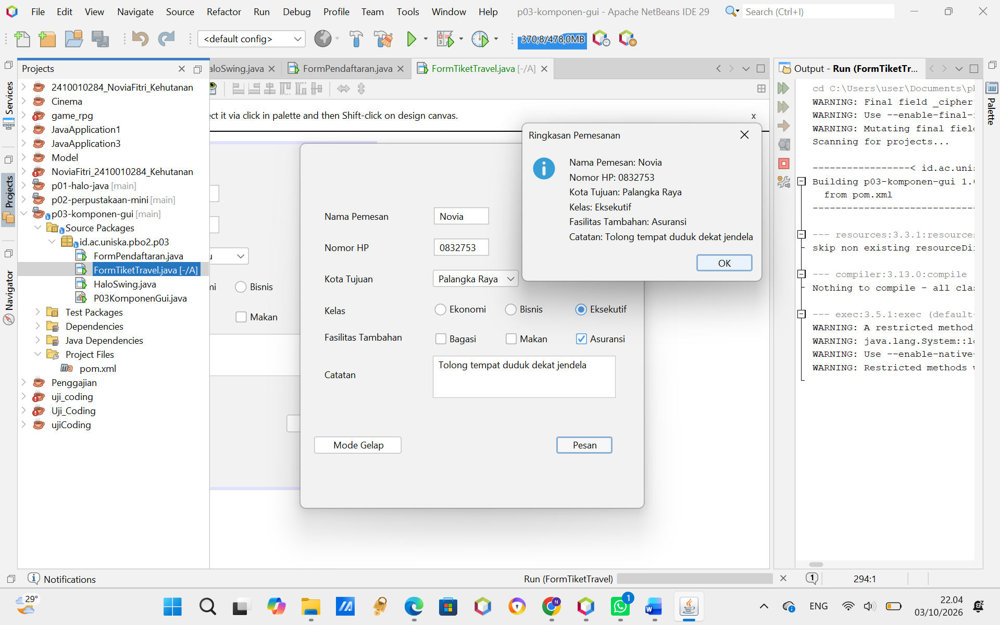
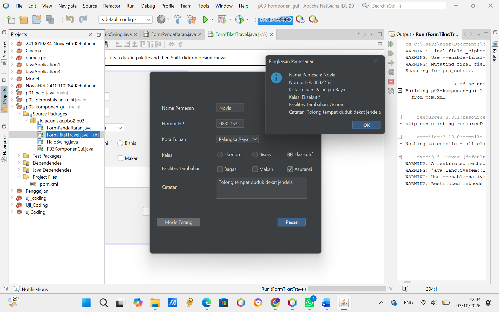
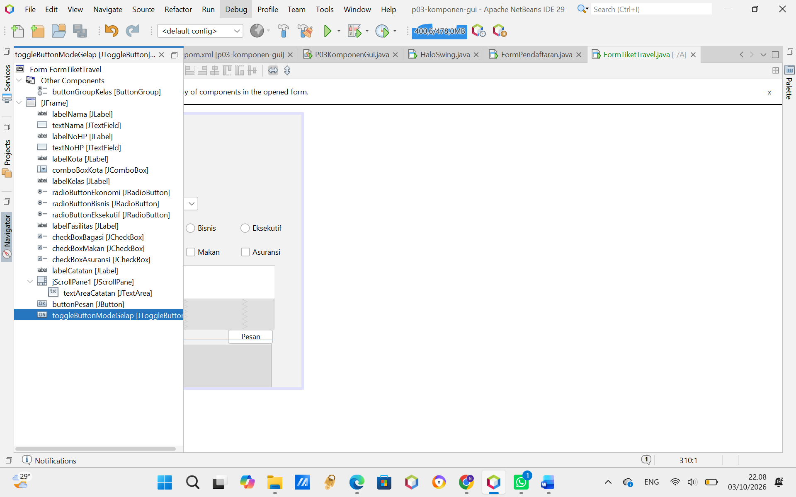

# Tugas Praktikum PBO 2 - Pertemuan 3: Komponen GUI Swing

- **Nama:** Novia Fitri
- **NPM:** 2410010284
- **Mata Kuliah:** Pemrograman Berbasis Objek 2 (PBO 2)

---

## 1. Tangkapan Layar (Screenshots) Form Pemesanan Tiket Travel Mode Terang

## 2. Tangkapan Layar (Screenshots) Form Pemesanan Tiket Travel Mode Gelap

## 3. Tangkapan Layar (Screenshots) tab Design FormTiketTravel yang memperlihatkan jendela Navigator;

---

## 2. Jawaban Eksperimen:

## 1. 
Perbedaannya:
• Top-level container: wadah paling luar aplikasi yang ada window-nya. Contohnya JFrame.
• Intermediate container: wadah di dalam frame buat ngerapikan tata letak komponen.
Contohnya JScrollPane.
• Atomic component: komponen dasar yang langsung dipakai user buat input atau klik.
Contohnya JButton.

## 2. 
Karena kalau nggak dimasukkan ke buttonGroup yang sama, pilihan radio button-nya bisa
terpilih semua sekaligus. Jadi buttonGroup ini fungsinya biar cuma bisa pilih salah satu aja.

## 3.
JComboBox dipakai kalau opsinya ada banyak (seperti daftar kota) supaya hemat tempat di
layar. Kalau JRadioButton dipakai kalau pilihannya cuma dikit (misal cuma 2-3 pilihan) biar
user bisa langsung lihat ketersediaan opsinya tanpa perlu ngeklik drop-down.

## 4.
Kode di initComponents() itu di-generate otomatis sama NetBeans dari tab Design. Kalau
diedit manual, kodenya bisa error atau kehapus otomatis pas form nya kita buka lagi di
Design. Kode tambahan ditulisnya di luar blok warna abu-abu, contohnya di bawah baris
initComponents() pada konstruktor atau bikin method sendiri di bawah.

## 5.
Supaya tema FlatLaf-nya di-load duluan sebelum komponen GUI-nya dibuat. Kalau dipanggil
setelah form-nya jadi, tampilan aplikasinya bakal muncul pakai tema bawaan Java yang lama
dulu baru berubah.
