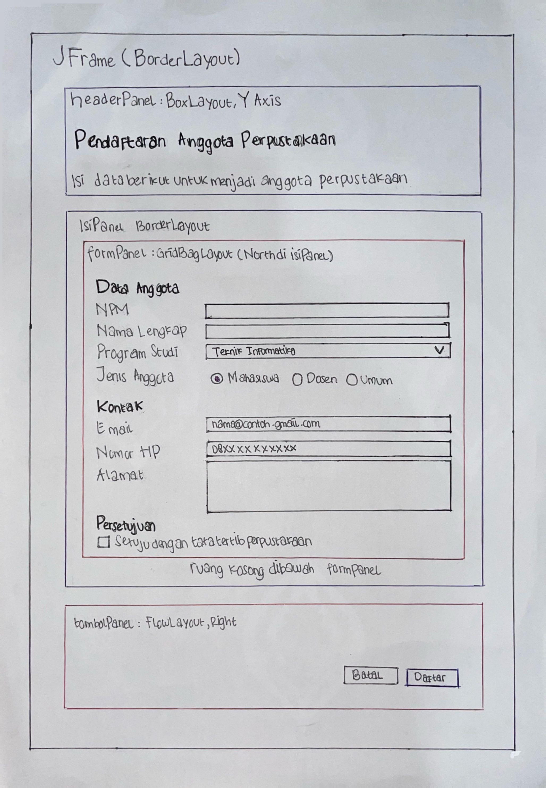
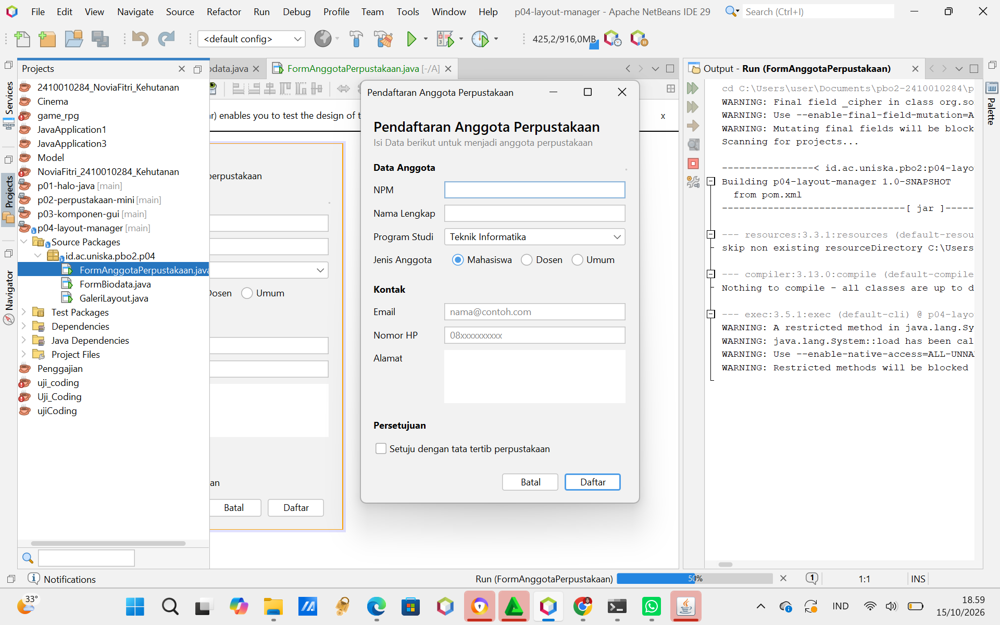
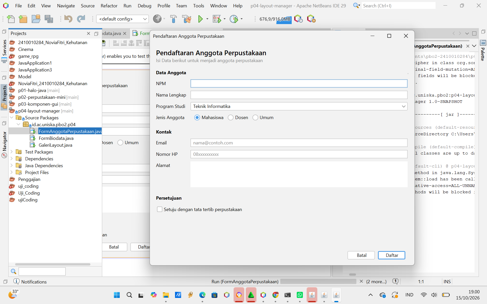
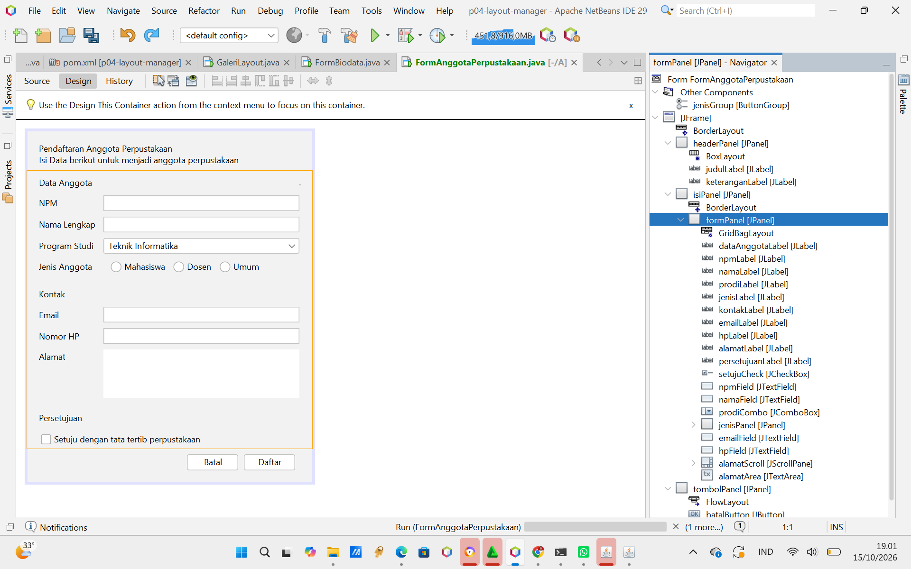

# Tugas Praktikum PBO 2 - Pertemuan 4: Layout Manager dan Desain Form

- **Nama:** Novia Fitri
- **NPM:** 2410010284
- **Mata Kuliah:** Pemrograman Berbasis Objek 2 (PBO 2)

---

## 1. Studio Desain: Form Anggota Perpustakaan

### **Tahap 1: Sketsa Form di Kertas**

---

### **Tahap 2: Tabel Rancangan**

| Bagian | Panel | Layout |
| :--- | :--- | :--- |
| **Jendela** | `FormAnggotaPerpustakaan` (JFrame) | BorderLayout |
| **Header** | `headerPanel` | BoxLayout (Y_AXIS) |
| **Isi form** | `isiPanel` (dibungkus `formPanel`) | BorderLayout & GridBagLayout |
| **Tombol** | `tombolPanel` | FlowLayout (Right) |

---

## 2. Tangkapan Layar (Screenshots) Form Anggota Perpustakaan

### **A. Ukuran Awal**

### **B. Saat Dilebarkan**

### **C. Tampilan Tab Design & Navigator NetBeans**

---

## 3. Jawaban Eksperimen

### **Jawaban Eksperimen Praktikum 2 (Galeri Layout):**
1. **FlowLayout Center:** Tombol pindah ke tengah. Saat jendela dikecilkan, tombol yang tidak muat turun ke baris bawah dan tetap rata tengah. Di kode `initComponents()`, `FlowLayout.LEFT` berubah jadi `FlowLayout.CENTER`.
2. **GridLayout Rows 0, Columns 2:** Terbentuk 5 baris. Karena `Rows` diatur `0`, jumlah baris dihitung otomatis dari 9 tombol ÷ 2 kolom = 4,5 lalu dibulatkan jadi 5 baris. Baris terakhir terisi 1 tombol.
3. **BoxLayout Maximum Size 32767:** Tombol melebar penuh selebar panel karena `BoxLayout` mengikuti ukuran maksimum komponen. *Vertical Strut* berfungsi menambah jarak vertikal antar tombol.

### **Jawaban Eksperimen Praktikum 4 (Form Biodata):**
1. **Weight X namaField 0.0:** `namaField` tetap melebar karena isian lain di kolom yang sama masih berbobot `Weight X 1.0` (lebar kolom mengikuti weight terbesar). Isian baru berhenti melebar jika semua komponen di kolom itu diubah jadi `0.0`.
2. **Direction formPanel (North ke Center):** `formPanel` tertarik memenuhi tinggi `isiPanel`, sehingga posisi baris form menyebar dan tidak menempel di atas lagi saat jendela ditinggikan.
3. **Tanpa setMinimumSize:** Jendela bisa dikecilkan sampai komponen tidak muat (Text Area Alamat mengecil duluan, lalu label terpotong). `setMinimumSize` digunakan agar ukuran jendela tidak bisa dikecilkan melebihi ukuran awal.
---

## 4. Tahap 4: Saling Menilai (Peer Review)

| No | Pemeriksaan | Ya atau Belum |
| :---: | :--- | :---: |
| 1 | Label singkat, jelas, dan sejajar | Ya |
| 2 | Isian dikelompokkan dengan judul bagian | Ya |
| 3 | Placeholder dipakai untuk isian yang punya format | Ya |
| 4 | Komponen sesuai jenis data | Ya |
| 5 | Tombol utama menonjol dan berada di kanan bawah | Ya |
| 6 | Jarak antar komponen konsisten | Ya |
| 7 | Form tetap rapi saat jendela dilebarkan dan ditinggikan | Ya |
| 8 | Tampilan dibuat dengan JFrame Form dan layout manager, bukan Null Layout atau Absolute Layout | Ya |

- **Saran Perbaikan dari Teman (Nabila Adhelia):** Form sudah rapi dan sesuai dengan contoh instruksi yang ada di modul. Tata letaknya udah pas dan nggak pakai Absolute Layout. Tinggal dipastikan aja batas ukuran minimumnya tetap aktif supaya bentuk jendela nya nggak berantakan.

---

## 5. Deklarasi Penggunaan AI
- **Alat AI yang digunakan:** Claude (Google)
- **Keperluan:**
- Membantu saya untuk memperjelas isi modul karena saya sempat stuck di latihan praktikum ke 3, Membantu saya mengkoreksi jawaban eksperimen dan tugas FormAnggotaPerpustakaan yang sudah saya kerjakan lalu saya belajar dari hasil koreksi nya.
