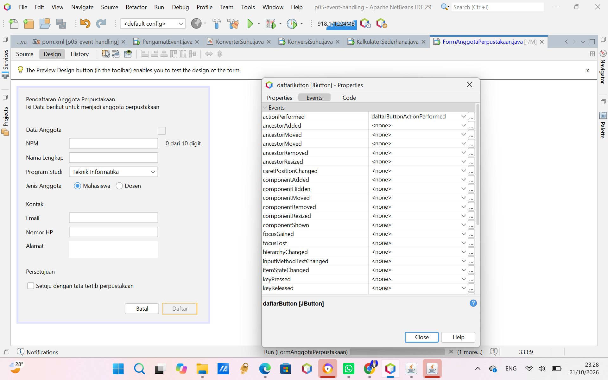
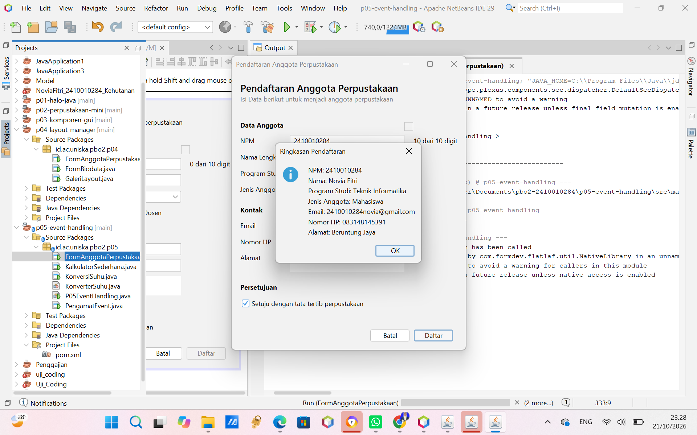
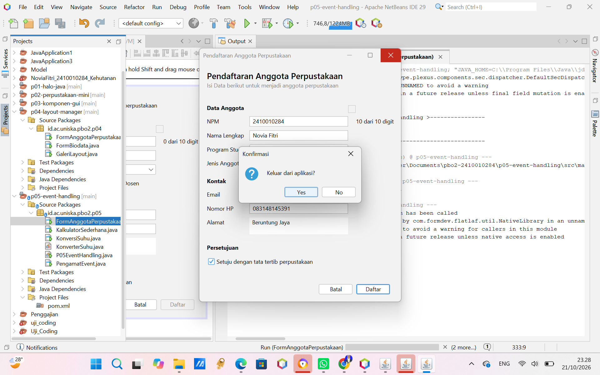

# Pertemuan 5: Event Handling (P05)

---

## 1. Tabel Pengamatan Praktikum 2

| No | Tindakan | Event yang Tercatat |
| :--- | :--- | :--- |
| **1** | Arahkan kursor ke tombol, lalu jauhkan | `MouseEvent` (kursor masuk ke tombol), 'MouseEvent' (kursor keluar dari tombol) |
| **2** | Klik tombol **Klik saya** | 'MouseEvent' (masuk), `ActionEvent` (tombol diklik) |
| **3** | Centang lalu hapus centang **Aktifkan fitur** | `ItemEvent` (kotak dicentang), `ItemEvent` (centang dihapus) |
| **4** | Ganti pilihan dari **Pagi** menjadi **Malam** | `ItemEvent` (memilih Malam) |
| **5** | Klik isian, lalu ketik kata **"abc"** | `FocusEvent` (isian mendapat fokus), `KeyEvent` (mengetik huruf a), `KeyEvent` (mengetik huruf b), `KeyEvent` (mengetik huruf c)  |
| **6** | Klik tombol setelah mengetik di isian | `MouseEvent` (masuk), 'Focus Event' (isian kehilangan fokus), `ActionEvent` (tombol diklik) |

---

## 2. Jawaban Eksperimen

### Eksperimen Praktikum 3 (Konversi Suhu)
1. **Pesan tercetak setelah `if` dihapus:**  
   Setelah pemeriksaan SELECTED dihapus, pesan “item berubah” tercetak 2 kali setiap pilihan satuan diganti. Hal ini terjadi karena itemStateChanged dipanggil dua kali, yaitu saat pilihan lama dilepas (DESELECTED) dan saat pilihan baru dipilih (SELECTED).
2. **Keterlambatan hasil pada `keyPressed`:**  
 Karena event `keyPressed` dipicu pas tombol keyboard ditekan *sebelum* karakternya bener-bener masuk ke dalam kotak teks, jadi `getText()` masih membaca teks yang sebelumnya.
3. **Hasil tanpa `try-catch` saat diisi huruf:**  
Program bakal langsung *error* (muncul `NumberFormatException` di konsol output) karena huruf abjad nggak bisa dipaksa masuk ke tipe data angka (`Double`). Aplikasi tidak tertutup, tapi hasilnya tidak di update.

### Eksperimen Praktikum 4 (Kalkulator Sederhana)
1. **Dua kali pesan & penanganan tombol:**  
   Pesan 'kali' bisa dobel karena ada dua listener yang jalan barengan (dari bawaan GUI Builder sama kode lambda). Makanya lebih baik pakai satu cara aja supaya perintahnya nggak tumpang tindih.
2. **Perubahan untuk Operator Modulus (`%`):**  
   - **Tab Design:** seret tombol baru dan ganti teksnya jadi `%`
   - **Tab Source:** Tambahin baris rumus baru di bagian switch/if, yaitu `case '%' -> a % b;`.
3. **Kursor kembali ke isian pertama:**  
  Karena di dalam method hapus kita udah nyelipin perintah `angka1Field.requestFocusInWindow();`, jadi kursornya langsung mandiri balik ke kotak pertama.

---

## 3. Peta Event - Form Anggota Perpustakaan

Tabel pemetaan event handling untuk Latihan Mandiri `FormAnggota`:

| Komponen | Menu Events | Aksi / Deskripsi |
| :--- | :--- | :--- |
| **Kotak Centang Setuju** (`setujuCheck`) | `Item` $\rightarrow$ `itemStateChanged` | Tombol **Daftar** hanya aktif jika kotak centang dicentang. |
| **Tombol Batal** (`batalButton`) | `Action` $\rightarrow$ `actionPerformed` | Mengosongkan seluruh isian form dan mengembalikan fokus kursor ke isian NPM. |
| **Tombol Daftar** (`daftarButton`) | `Action` $\rightarrow$ `actionPerformed` | Menampilkan ringkasan data yang diisi menggunakan dialog `JOptionPane`. |
| **Isian NPM** (`npmField`) | `Key` $\rightarrow$ `keyReleased` | Menampilkan indikator jumlah digit NPM secara dinamis (misal: "8 dari 10 digit"). |
| **Form** (`JFrame` di Navigator) | `Window` $\rightarrow$ `windowClosing` | Menampilkan dialog konfirmasi `JOptionPane` sebelum jendela ditutup. |

---

## 4. Tangkapan Layar (Screenshots)

Berikut adalah lampiran tangkapan layar pengujian aplikasi Latihan Mandiri *Form Anggota Perpustakaan*:

1. **Jendela Properties Bagian Events (Tombol Daftar):**  
   

2. **Dialog Ringkasan Pendaftaran (`JOptionPane`):**  
   

3. **Dialog Konfirmasi Keluar Aplikasi (`Window Closing`):**  
   

---

## 5. Deklarasi Penggunaan AI

Aplikasi yang digunakan : Claude
Deklarasi Penggunaan : membantu saya saat saya kebingungan membuat kode yang ada di npmField dan batalButton. Lalu saya gunakan juga untuk mengkoreksi hasil tugas mandiri saya. 
