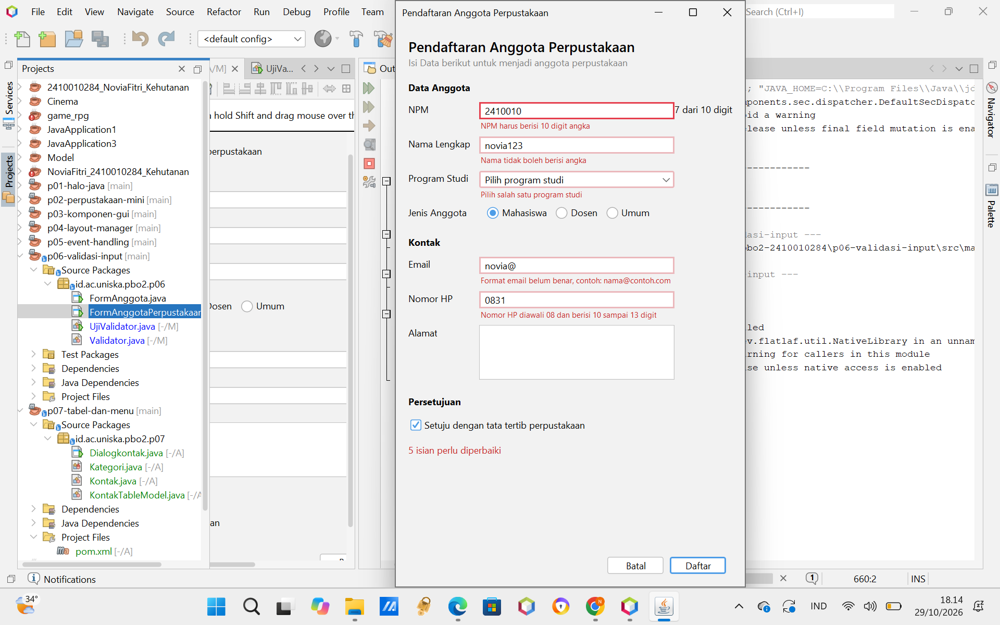
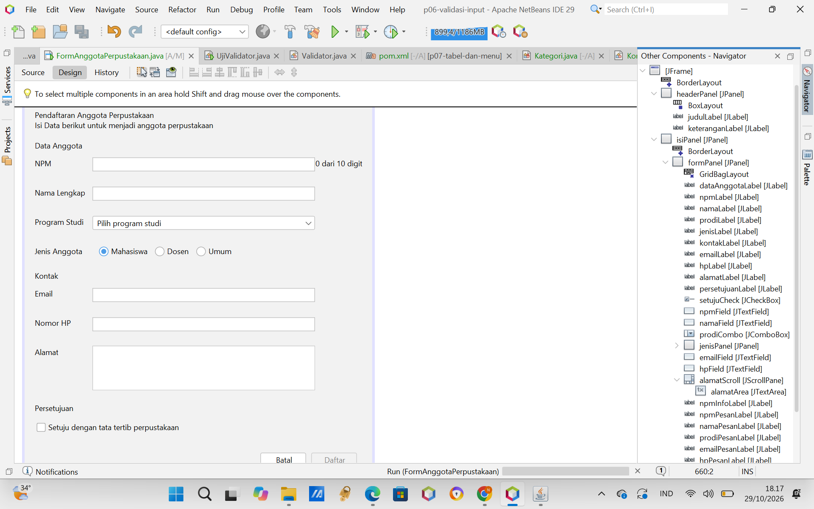

# Pertemuan 6: Validasi Input dan Kegunaan (P06)

---

## 1. Jawaban Eksperimen (Praktikum 4)

1. **Ketik huruf pada isian NPM. Apa yang terjadi dan baris mana di npmFieldKeyTyped yang menyebabkannya?**:                                     Saat di ketik huruf tidak ada muncul apa apa dalam kotak isian, ini di sebabkan  karena di npmFieldKeyTyped terdapat kode " if (!Character.isDigit(evt.getKeyChar()) || penuh) { 
        evt.consume();" itu lah yang menyebabkan huruf tidak masuk ke kotak isian.
        
2. **Isi email dengan `siti@`, lalu tekan Tab:**  
   Pesan kesalahan muncul saat fokus keluar dari isian (`event focusLost`), bukan pada saat pengguna sedang mengetik.

3. **Klik isian Nama tanpa mengetik, lalu tekan Tab. Mengapa tidak ada pesan kesalahan?:**  
   Tidak ada pesan apapun karena focusLost hanya memeriksa jika isian tidak kosong (!isBlank()). Isian kosong baru diperiksa saat Daftar diklik.

4. **Centang persetujuan, lalu klik Daftar dengan form kosong, isian mana yang mendapat fokus:**  
   Fokus ke NPM, karena itu kesalahan pertama yang ada di urutan pemeriksaan.

5. **Tekan tombol Alt bersama huruf N. Isian mana yang mendapat fokus, dan properti apa yang mengaturnya?:**  
 Diatur oleh properti displayedMnemonic pada label Nama (dan terhubung ke isian lewat labelFor).

6. **Isi beberapa isian, lalu klik Batal dan pilih No. Apakah data tetap ada?:** 
   Data tetap ada, karena batal() melakukan return sebelum kosongkan().

---

## 2. Tangkapan Layar (Screenshots)

Berikut adalah lampiran tangkapan layar pengujian aplikasi *Form Anggota Perpustakaan*:

1. **Form dengan Pesan Kesalahan:**  
   

2. **Jendela Navigator:**  
   

---

## 3. Lembar Peer Review & Tabel Perbaikan

### A. Lembar Peer Review
Berikut adalah lembar *peer review* yang diterima dari Nuriatun Syalma:
| No | Heuristik | Temuan | Skor 0-4 | Saran |
| :---: | :--- | :--- | :---: | :--- |
| **1** | Visibilitas status sistem | Sistem memberikan informasi yang jelas ketika pengguna menekan tombol "Daftar". Pengguna dapat mengetahui status atau hasil dari tindakan yang dilakukan. | 0 | Pertahankan informasi status sistem agar pengguna tetap mengetahui hasil dari setiap tindakan. |
| **2** | Kesesuaian dengan dunia nyata | Label dan tombol seperti "Daftar" dan "Batal" menggunakan bahasa yang mudah dipahami dan sesuai dengan kebiasaan pengguna. | 0 | Pertahankan penggunaan bahasa yang sederhana dan mudah dimengerti. |
| **3** | Kendali dan kebebasan pengguna | Tombol "Batal" dan dialog konfirmasi berfungsi dengan baik. Pengguna dapat membatalkan tindakan dan memilih untuk mempertahankan data yang sudah diisi. Akan tetapi, setelah pengguna memilih "No" pada dialog konfirmasi, fokus kursor tidak otomatis kembali ke kolom isian, sehingga pengguna harus klik manual pakai mouse. | 2 | Pertahankan fungsi konfirmasi agar pengguna dapat mengendalikan tindakannya dengan aman. Dan kembalikan fokus kursor secara otomatis ke kolom yang terakhir aktif menggunakan kode `requestFocusInWindow()`. |
| **4** | Konsistensi dan standar | Tulisan, label, tombol, dan susunan komponen memiliki tampilan yang konsisten sehingga form mudah digunakan. | 0 | Pertahankan konsistensi tampilan dan penulisan pada seluruh bagian form. |
| **5** | Pencegahan kesalahan | Validasi input berjalan dengan baik untuk membantu mencegah kesalahan pengisian data, termasuk pada kolom NPM dan nomor HP. | 0 | Pertahankan validasi input agar kesalahan pengisian dapat dicegah sejak awal. |
| **6** | Mengenali, bukan mengingat | Label dan petunjuk pengisian terlihat jelas sehingga pengguna dapat mengetahui informasi yang perlu dimasukkan tanpa harus mengingat aturan pengisian. | 0 | Pertahankan petunjuk pengisian agar tetap mudah ditemukan dan dipahami. |
| **7** | Fleksibilitas dan efisiensi | Navigasi menggunakan tombol Tab dan tombol keyboard lainnya berjalan dengan baik sehingga pengguna dapat mengisi form dengan lebih praktis. | 0 | Pertahankan fungsi navigasi keyboard agar proses pengisian tetap efisien. |
| **8** | Desain estetis dan minimalis | Tampilan form terlihat rapi, mudah dibaca, dan memiliki jarak antarkomponen yang sesuai. Tidak ditemukan tulisan bertumpuk atau terpotong. | 0 | Pertahankan tata letak dan tampilan form agar tetap nyaman digunakan. |
| **9** | Membantu memperbaiki kesalahan | Pesan kesalahan ditampilkan dengan jelas dan membantu pengguna mengetahui kesalahan serta cara memperbaiki input yang tidak sesuai. | 0 | Pertahankan pesan kesalahan yang informatif agar pengguna mudah memperbaiki kesalahan pengisian. |
| **10** | Bantuan dan dokumentasi | Form menyediakan petunjuk pengisian melalui label atau tooltip sehingga pengguna dapat memahami aturan pengisian dengan lebih mudah. | 0 | Pertahankan petunjuk dan tooltip agar pengguna tetap terbantu saat mengisi form. |
### B. Tabel Singkat Temuan, Perbaikan, dan Commit

| No | Temuan dari Teman | Perbaikan yang Dilakukan | Commit yang Memuat Perbaikan |
| :--- | :--- | :--- | :--- |
| **1** | Tombol "Batal" dan dialog konfirmasi berfungsi dengan baik, namun setelah memilih "No" pada dialog konfirmasi, fokus kursor tidak otomatis kembali ke kolom isian sehingga harus diklik manual pakai mouse. (Skor: 2) | Menambahkan kode `npmField.requestFocusInWindow()` pada method batal agar fokus kursor otomatis kembali ke kolom isian utama (NPM) setelah pengguna memilih "No".| `P06: Perbaikan fokus kursor pembatalan` |

---

## 4. Deklarasi Penggunaan AI

- **Aplikasi yang digunakan:** Claude
- **Deklarasi Penggunaan:** Memperjelas isi modul, membantu untuk mengkoreksi hasil tugas mandiri.
