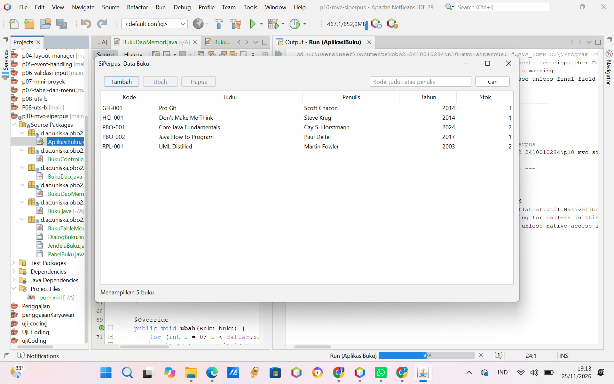
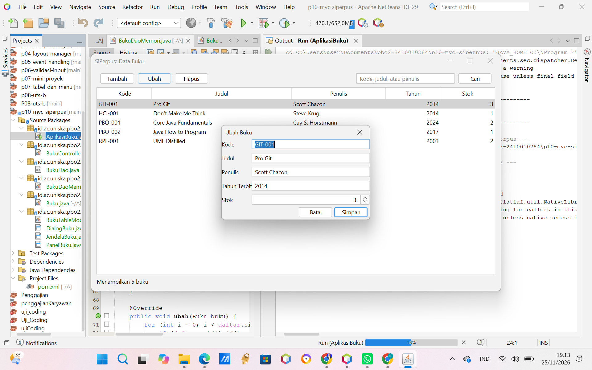
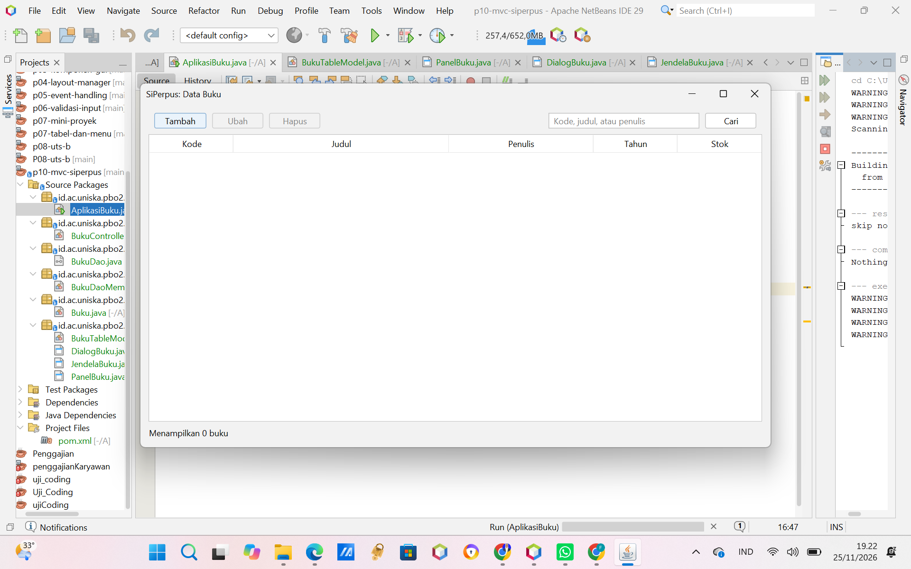
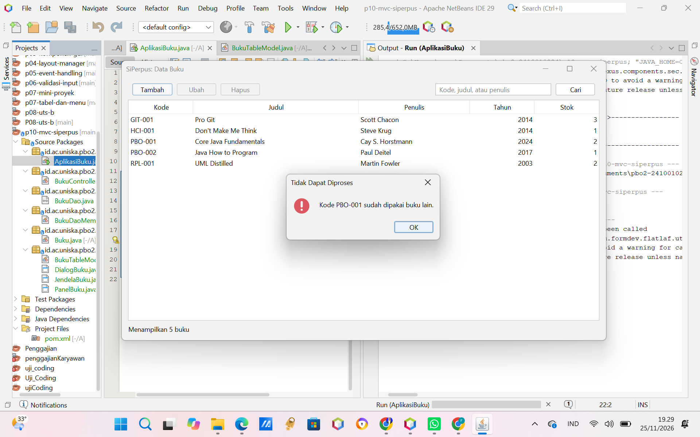
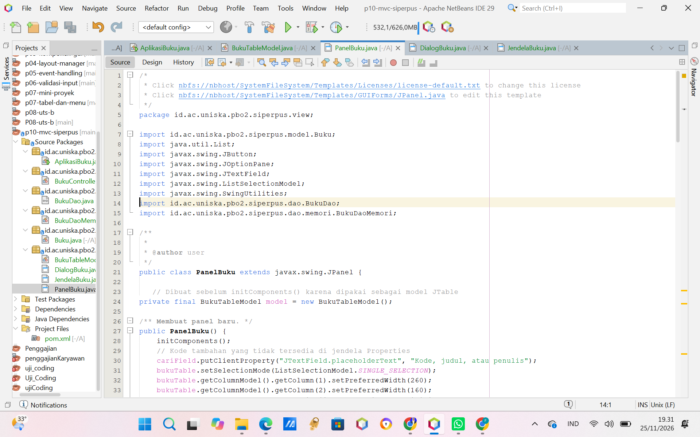
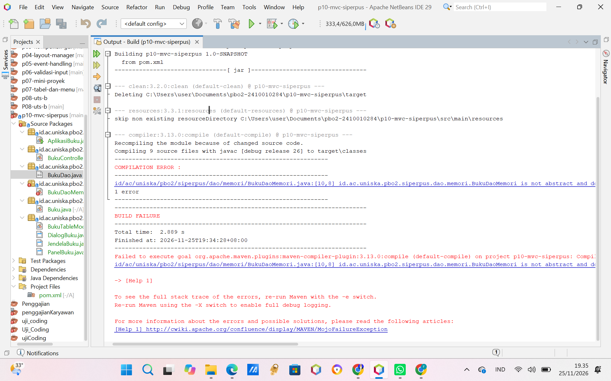
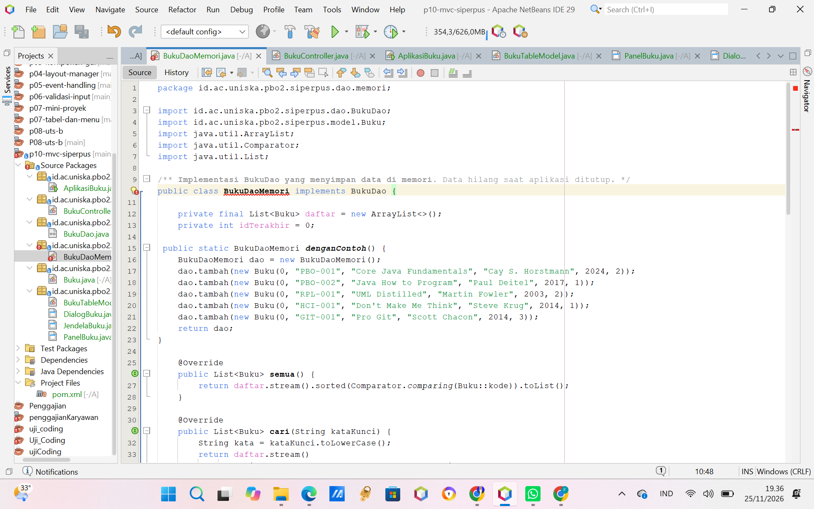
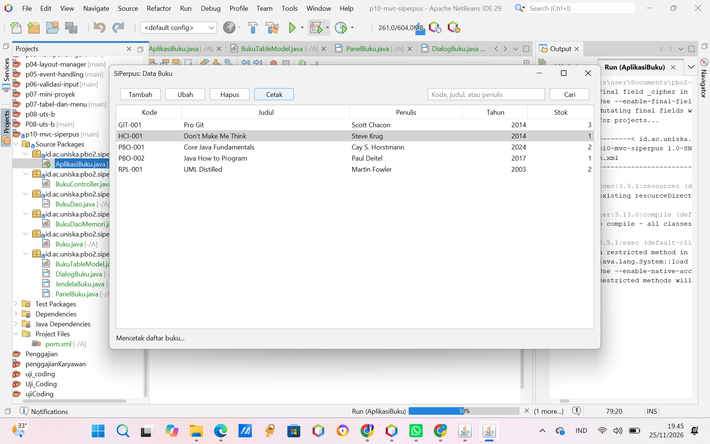
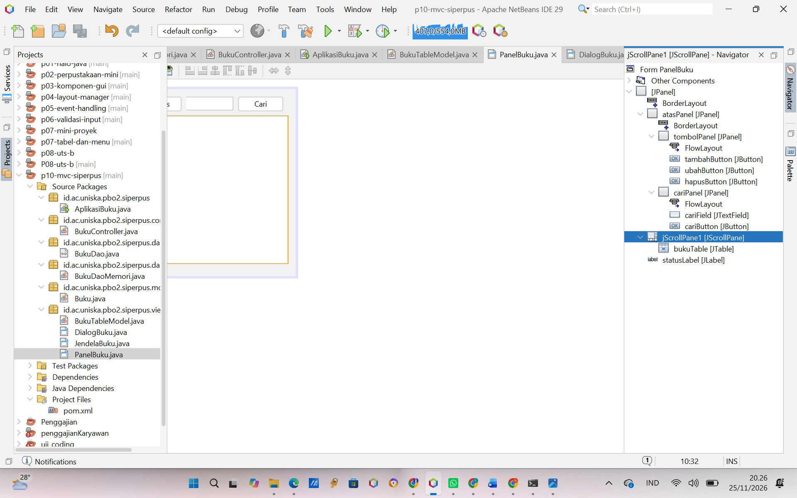

# Pertemuan 10: Class Diagram dan Struktur Proyek MVC (P10)
 
---
 
## 1. Jawaban Eksperimen dan Refleksi
 
### A. Eksperimen (Praktikum 6)
 
1. **Di AplikasiBuku, ganti `BukuDaoMemori.denganContoh()` menjadi `new BukuDaoMemori()`. Apa yang tampil saat aplikasi dibuka, dan kelas mana saja yang perlu diubah?**
   Tabel kosong dan status menampilkan "Menampilkan 0 buku", karena `new BukuDaoMemori()` tidak mengisi data contoh. Hanya `AplikasiBuku` yang perlu diubah, sedangkan controller dan view tidak karena hanya mengenal interface `BukuDao`.
2. **Tambahkan buku berkode PBO-001. Perhatikan isi dialog yang muncul kembali setelah pesan kesalahan.**
   Muncul pesan "Kode PBO-001 sudah dipakai buku lain", lalu dialog terbuka lagi dengan isian sebelumnya masih terisi sehingga tidak perlu mengetik ulang. Hal ini karena `BukuController.tambah()` memakai loop `while (true)` yang membuka dialog lagi selama kodenya masih ganda.
3. **Coba pindahkan pemanggilan `dao.hapus` ke dalam PanelBuku. Kelas apa yang sekarang harus diimpor oleh PanelBuku, dan mengapa hal ini melanggar pola MVC?**
   `PanelBuku` harus mengimpor `BukuDao` (dan `BukuDaoMemori` untuk membuat objeknya). Ini melanggar MVC karena view jadi ikut mengurus data, padahal tugasnya hanya menampilkan. Akibatnya view bergantung pada cara penyimpanan dan sulit dipakai ulang.
4. **Tambahkan method `List<Buku> stokHabis();` pada interface BukuDao. Kelas mana yang langsung gagal dikompilasi, dan mengapa?**
   `BukuDaoMemori` gagal dikompilasi dengan pesan "does not override abstract method stokHabis()". Alasannya, kelas yang `implements` interface wajib mengisi semua method-nya, sedangkan `stokHabis()` belum ditulis di sana.
5. **Di tab Design PanelBuku, tambahkan tombol Cetak ke tombolPanel tanpa membuat event. Kelas mana yang perlu diubah agar tombol itu melakukan sesuatu, dan mengapa bukan PanelBuku?**
   `BukuController` yang perlu diubah, yaitu memasang listener pada tombol Cetak dan membuat method `cetak()`. Bukan `PanelBuku` karena view hanya menyusun tampilan, sedangkan menanggapi aksi pengguna adalah tugas controller.
### B. Pertanyaan Refleksi
 
1. **Apa perbedaan garis inheritance dan realization pada class diagram?**
   Inheritance memakai garis utuh dan dipakai untuk kelas yang mewarisi kelas lain (`extends`). Realization memakai garis putus-putus dan dipakai untuk kelas yang mengimplementasikan interface (`implements`). Keduanya berkepala segitiga kosong.
2. **Mengapa atribut `dao` pada BukuController bertipe `BukuDao`, bukan `BukuDaoMemori`?**
   Supaya controller tidak terikat pada satu cara penyimpanan. Jika penyimpanan diganti, controller tidak perlu diubah, cukup objek yang dibuat di `AplikasiBuku`.
3. **Tanggung jawab apa yang tidak boleh ada di kelas view?**
   View tidak boleh mengakses data atau memanggil DAO. Tugasnya hanya menyusun komponen dan menampilkan data, sedangkan pemanggilan model dilakukan controller.
4. **Relasi dan multiplicity apa yang paling penting pada topik kelompok Anda?**
   Pada Aplikasi Reservasi Lapangan Olahraga, yang terpenting adalah Pelanggan 1 ke 0..* Reservasi dan Lapangan 1 ke 0..* Reservasi, supaya jadwal yang bentrok dapat dicegah. Selain itu, satu Reservasi memiliki 0..1 Pembayaran karena bisa saja belum dibayar.
5. **Jika penyimpanan diganti MySQL, kelas mana saja yang perlu diubah?**
   Cukup membuat kelas baru `BukuDaoJdbc` yang `implements BukuDao`, mengubah satu baris di `AplikasiBuku`, dan menambah driver MySQL di `pom.xml`. Controller, view, dan model tidak berubah.
---
 
## 2. Tangkapan Layar (Screenshots)
 
Berikut adalah lampiran tangkapan layar pengujian aplikasi *SiPerpus: Data Buku*:
 
1. **Hasil Akhir Tampilan:**  
     
   Aplikasi dengan 5 buku contoh dan status "Menampilkan 5 buku".
2. **Dialog Ubah Buku:**  
     
   Dialog Ubah Buku yang terisi data buku yang dipilih.
4. **Eksperimen 1, Tabel Kosong:**  
     
   Tabel kosong dan status "Menampilkan 0 buku" setelah memakai `new BukuDaoMemori()`.
5. **Eksperimen 2, Pesan Kode Ganda:**  
     
   Pesan "Kode PBO-001 sudah dipakai buku lain" saat menambah kode yang sudah ada.
6. **Eksperimen 3, Import DAO di View:**  
     
   Kode `PanelBuku` dengan import `BukuDao` dan `BukuDaoMemori`.
7. **Eksperimen 4, Error Build:**  
     
   Output `COMPILATION ERROR` dan `BUILD FAILURE` karena `stokHabis()` belum diimplementasikan.
8. **Eksperimen 4, Error di BukuDaoMemori:**  
     
   Garis merah dan pesan error pada `BukuDaoMemori.java`.
9. **Eksperimen 5, Tombol Cetak di Aplikasi:**  
      
    Tombol Cetak tampil di aplikasi tetapi belum berfungsi karena belum ada listener.
10. **Struktur Proyek dan Jendela Navigator PanelBuku:**  
      
    Paket proyek beserta file `.form`, dan susunan komponen `PanelBuku` di Navigator.

---
 
## 3. Deklarasi Penggunaan AI
 
- **Aplikasi yang digunakan:** Claude
- **Deklarasi Penggunaan:** Memperjelas isi modul, membantu memahami langkah eksperimen.
 
